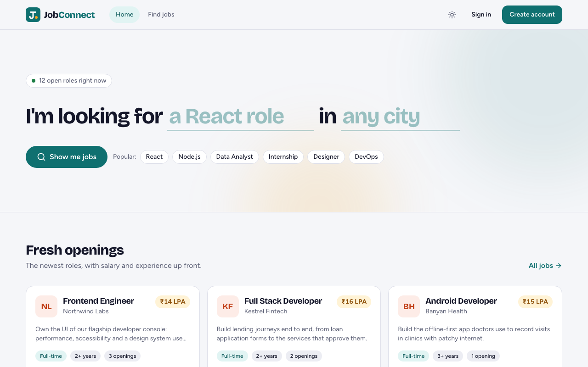
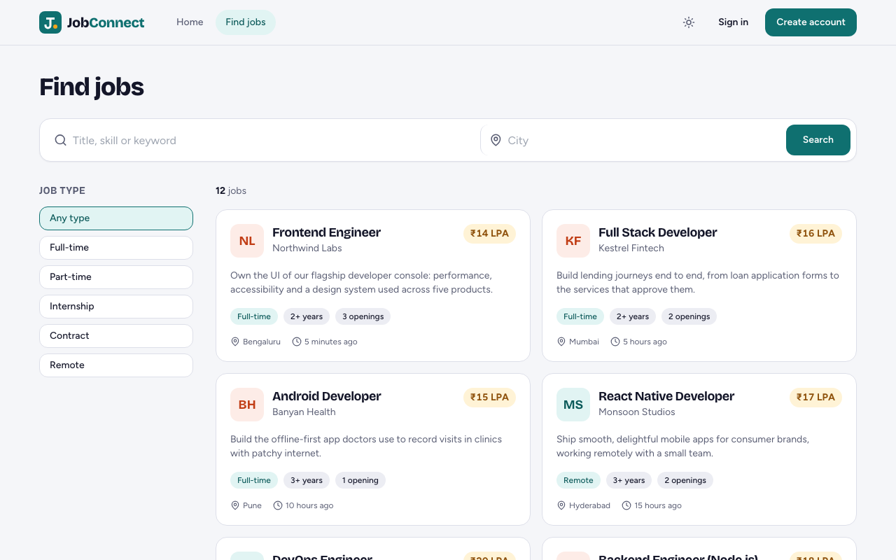
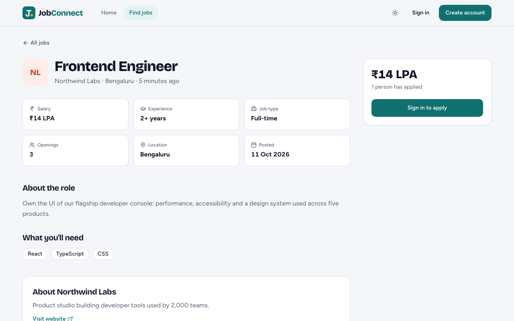
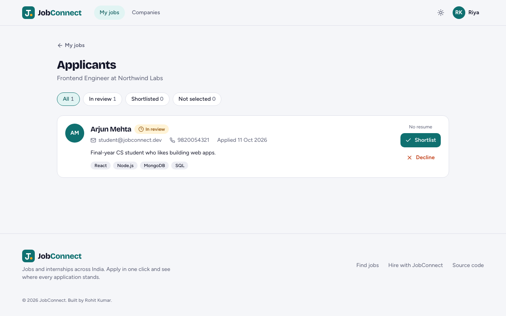
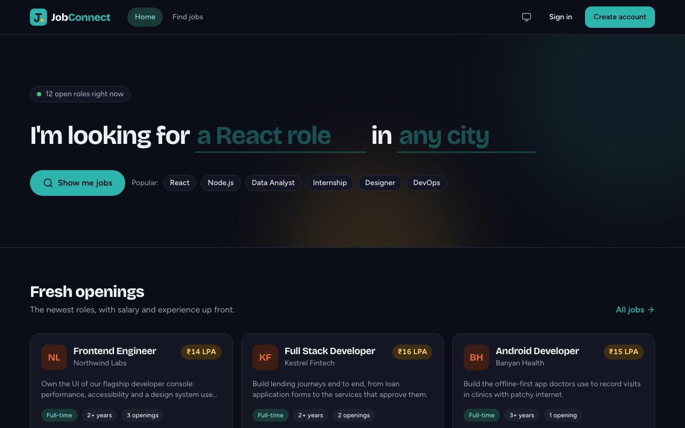

# JobConnect

A job portal for India: job seekers search and apply in one click, recruiters post jobs and shortlist applicants.

**Live:** https://jobconnect-portal-alpha.vercel.app

| Demo account | Email | Password |
|---|---|---|
| Job seeker | `student@jobconnect.dev` | `Demo@1234` |
| Recruiter | `recruiter@jobconnect.dev` | `Demo@1234` |

Or create your own account; choose "Job seeker" or "Recruiter" when you sign up.



## What it does

**Job seekers**
- Search by title, skill or keyword, filter by city and job type. Filters live in the URL, so a search can be shared.
- Every listing shows salary (₹ LPA), experience, openings and how long ago it was posted.
- Profile with photo, bio, skills and a PDF resume; applying sends the resume along.
- Apply in one click, once per job. Track each application: In review, Shortlisted or Not selected.

**Recruiters**
- Register companies with logo, description, website and location.
- Post, edit and delete jobs. Deleting a job removes its applications.
- See applicants with contact details, skills and resume; shortlist or decline in one click.

**Everyone**
- Light and dark themes, works on phones, keyboard and screen-reader friendly.

| | |
|---|---|
|  |  |
|  |  |

## Stack

| Part | Tech |
|---|---|
| Frontend | React 18, Vite, Tailwind CSS, React Query, React Router |
| API | Node.js, Express 5, Mongoose, Zod |
| Database | MongoDB (Atlas in production) |
| Files | Private AWS S3 bucket, read through signed links that expire in an hour |
| Auth | JWT in an HttpOnly cookie, bcrypt password hashes |
| Tests | Vitest + Supertest + in-memory MongoDB (API), Vitest + Testing Library (UI), Playwright (end to end) |
| Hosting | Vercel: the web app and a serverless API in Mumbai (`bom1`) |

## Run it locally

You need Node.js 20+ and MongoDB (local `mongod`, Docker, or an Atlas connection string).

```bash
git clone https://github.com/kumarrohitkumar/Job_Portal.git
cd Job_Portal
npm install                       # installs the root, backend and frontend
cp backend/.env.example backend/.env
npm run dev                       # API on :8000, web on http://localhost:5173
```

The defaults work as is: MongoDB at `mongodb://127.0.0.1:27017/jobportal`, and `SEED_ON_START=true` fills an empty database with five fictional companies, twelve jobs and the two demo accounts. Without S3 settings, uploads are kept in memory (lost on restart). `npm run seed` resets the demo data at any time and leaves other accounts alone.

### Environment (`backend/.env`)

| Variable | Needed | Notes |
|---|---|---|
| `MONGO_URI` | yes | Defaults to a local MongoDB |
| `JWT_SECRET` | in production | At least 32 characters (`openssl rand -hex 32`) |
| `NODE_ENV` | | `production` turns on secure cookies and requires the two settings above plus S3 |
| `S3_BUCKET`, `S3_REGION`, `S3_ACCESS_KEY_ID`, `S3_SECRET_ACCESS_KEY` | for real uploads | An IAM user allowed only `s3:PutObject`, `GetObject` and `DeleteObject` on that bucket |
| `SEED_ON_START` | | `true` seeds an empty database |
| `CORS_ORIGINS` | | Only if the web app is on another origin; locally Vite proxies `/api` |
| `TRUST_PROXY_HOPS` | | `1` behind Vercel, so rate limits see the real client IP |

## Tests

```bash
npm test                 # API (33) and UI (10) tests
npm run test:e2e         # Playwright journey against http://localhost:5173 (run `npm run dev` first)
BASE_URL=https://jobconnect-portal-alpha.vercel.app npm run test:e2e   # the same journey against the live site
```

The end-to-end journey signs up a recruiter, registers a company with a logo and posts a job; signs up a job seeker who uploads a resume and applies; the recruiter shortlists them and the job seeker sees it; it checks role rules in the app and the API, then edits and deletes the job, plus a phone-sized run. It creates accounts named `e2e.*@example.com`.

## API

All routes are under `/api/v1`. Errors are `{ success: false, message, errors? }` with a fitting status code (400 validation, 401 not signed in, 403 wrong role, 404 not found or not yours, 409 duplicate, 429 too many sign-in attempts).

| Method | Path | Who | What |
|---|---|---|---|
| POST | `/auth/register` | anyone | Create an account and sign in |
| POST | `/auth/login` | anyone | Sign in (10 failed tries per 15 min per email and IP) |
| POST | `/auth/logout` | anyone | Sign out |
| GET | `/auth/session` | anyone | The signed-in user, or `null` |
| GET | `/auth/me` | signed in | The signed-in user (401 otherwise) |
| PATCH | `/users/me` | signed in | Profile fields, plus optional `resume` (PDF) and `photo` (JPG/PNG/WebP) files, 2 MB each |
| GET | `/jobs?keyword=&location=&jobType=&limit=` | anyone | Search jobs, newest first |
| GET | `/jobs/:id` | anyone | One job with applicant count; `hasApplied` and `myStatus` for the signed-in seeker |
| GET | `/jobs/mine` | recruiter | Own jobs with applicant counts |
| POST | `/jobs` | recruiter | Post a job for one of your companies |
| PATCH / DELETE | `/jobs/:id` | owner | Edit or delete a job |
| POST | `/jobs/:id/apply` | job seeker | Apply (once) |
| GET | `/jobs/:id/applicants` | owner | Applicants with profile and resume link |
| GET | `/applications/mine` | job seeker | Own applications with job and status |
| PATCH | `/applications/:id/status` | job owner | `pending`, `accepted` or `rejected` |
| POST / GET | `/companies` | recruiter | Register a company / list your companies |
| GET / PATCH | `/companies/:id` | owner | Read or update, with an optional `logo` file |

## Security notes

- Roles and ownership are checked on the server for every route; the UI hides what you can't do, but the API is the gate.
- Passwords are hashed with bcrypt and never returned. Sessions are 7-day JWTs in an HttpOnly, SameSite=Lax cookie (Secure in production).
- Uploads are checked by their bytes, not their name, and capped at 2 MB. Files sit in a private bucket; links are signed and expire.
- Search text is escaped before it reaches a regular expression, inputs are validated with Zod, and responses carry Helmet's security headers.

## Deploying

Two Vercel projects from this repo:

- `backend/` (API): set the environment variables above with `NODE_ENV=production`. `backend/vercel.json` runs it as one serverless function in Mumbai.
- `frontend/` (web): `frontend/vercel.json` rewrites `/api/*` to the API project, so the browser talks to one origin and the session cookie stays first-party. Change that URL if your API project has another name.

MongoDB Atlas needs to allow connections from Vercel (`0.0.0.0/0` on the free tier). The database user only needs `readWrite` on the app's database.

---

## My live projects

| Project | What it does | Stack | Live | Code | Demo login |
|---|---|---|---|---|---|
| **Kosh LMS** | Loan management: borrowers apply (eligibility rules, salary slip, simple interest); teams sanction, disburse and collect | Next.js · Express · MongoDB · S3 | [kosh-lms.vercel.app](https://kosh-lms.vercel.app) | [lms-assignment](https://github.com/kumarrohitkumar/lms-assignment) | `admin@lms.dev` / `Password@123` |
| **JobConnect** (this repo) | Job portal: seekers search and apply in one click; recruiters post jobs and shortlist | React · Express · MongoDB · S3 | [jobconnect-portal-alpha.vercel.app](https://jobconnect-portal-alpha.vercel.app) | [Job_Portal](https://github.com/kumarrohitkumar/Job_Portal) | `student@jobconnect.dev` / `Demo@1234` |
| **Chatify** | Real-time direct and group chat with typing, read receipts and photos | React · Socket.IO · MongoDB · AWS EC2 | [chatify-13-205-125-184.sslip.io](https://chatify-13-205-125-184.sslip.io) | [chat_app](https://github.com/kumarrohitkumar/chat_app) | `ananya@demo.chat` / `demo1234` |
| **Finishh club** | Explains Indian mutual funds, IPOs and stocks in plain English, never tells you what to buy | React · FastAPI (Python) | [finishh-club.vercel.app](https://finishh-club.vercel.app) | [finishh-club](https://github.com/kumarrohitkumar/finishh-club) | No login needed |
